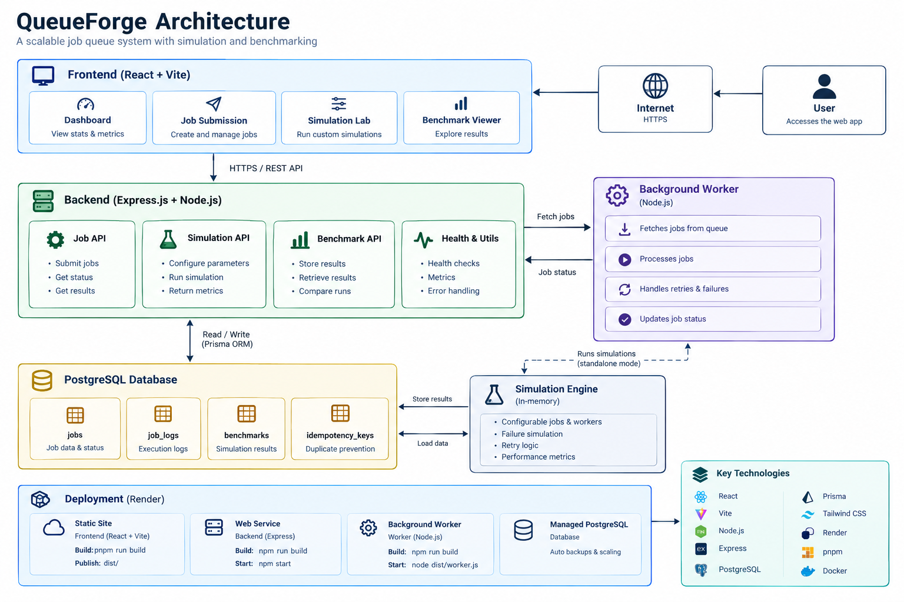

# QueueForge

**A PostgreSQL-backed background job queue with a React simulation and benchmark dashboard.**

QueueForge demonstrates reliable job submission and processing patterns using Node.js, TypeScript, Express, and PostgreSQL. The repository includes an API, a separate worker process, database migrations, automated tests, a configurable in-browser simulation, and recorded benchmark artifacts.

> **Measurement note:** Simulation Lab numbers are generated by a local simulation model. Benchmark Lab displays recorded measurements from the repository. Neither should be represented as a production-capacity guarantee.

## Contents

- [Features](#features)
- [Architecture](#architecture)
- [Technology stack](#technology-stack)
- [Local setup](#local-setup)
- [Run the application](#run-the-application)
- [API reference](#api-reference)
- [Simulation and benchmarks](#simulation-and-benchmarks)
- [Tests and builds](#tests-and-builds)
- [Deployment](#deployment)
- [Security and limitations](#security-and-limitations)
- [Project structure](#project-structure)

## Features

### Backend

- REST API for submitting jobs and retrieving an individual job by UUID.
- Persistent job state in PostgreSQL.
- Idempotent submission using the optional `Idempotency-Key` header.
- Priority ordering and scheduled execution via `runAt`.
- Concurrent job claiming with PostgreSQL transactions and `FOR UPDATE SKIP LOCKED`.
- Worker leases, heartbeats, lease expiry recovery, and ownership checks.
- Retry and dead-letter behavior after attempts are exhausted.
- Liveness, readiness, and job-count metrics endpoints.
- Automated API, handler, worker, and heartbeat tests.

### Dashboard

- **Overview:** API/database health and job counts from the real backend.
- **Simulation Lab:** configurable job counts, worker lanes, workload, failure probability, retries, playback controls, and simulated metrics.
- **Benchmark Lab:** historical benchmark artifacts bundled with the frontend.
- **Submit Job:** submits a real job to the API.
- **Job Explorer:** retrieves a real job using its UUID.
- **Settings:** configures the API origin for the current browser.

## Architecture



The API and worker are separate processes. The frontend simulation runs in the browser and does not start or scale real workers. Benchmark Lab displays saved benchmark records; it does not launch a benchmark from the public browser.

## Technology stack

| Area | Technology |
|---|---|
| API and worker | Node.js, TypeScript, Express 5 |
| Persistence | PostgreSQL 17, `pg` |
| Input validation | Zod |
| Dashboard | React 19, TypeScript, Vite 8, Tailwind CSS 4 |
| Backend tests | Vitest, Supertest |
| Frontend tests | Vitest |
| Local database | Docker Compose |

## Local setup

### Prerequisites

- Node.js 22 or another supported Node.js version compatible with the lockfiles.
- npm for the backend.
- Corepack/pnpm for the frontend.
- Docker Desktop with Docker Compose, or a compatible local PostgreSQL instance.
- Git.

### 1. Install backend dependencies

From the repository root:

```bash
npm ci
```

### 2. Configure the database

Create `.env` from the example and edit the password for your local PostgreSQL instance:

```bash
cp .env.example .env
```

The root `.env.example` uses these variables:

```dotenv
POSTGRES_PASSWORD=change_me_for_local_development
DB_HOST=localhost
DB_PORT=5432
DB_NAME=queueforge
DB_USER=queueforge
PORT=3000
```

`POSTGRES_PASSWORD` is used by both Docker Compose to initialize a new database volume and by the backend PostgreSQL pool. Do not commit `.env` or real credentials. If a Docker volume already exists, changing `POSTGRES_PASSWORD` in the file does not change the password already stored in that database volume.

Start PostgreSQL:

```bash
docker compose up -d postgres
docker compose ps
```

### 3. Apply migrations once

If you are creating a fresh database, apply migrations in numeric order from the repository root. The following redirection syntax is for Git Bash or another POSIX-like shell:

```bash
docker exec -i queueforge-postgres psql -U queueforge -d queueforge < migrations/001_create_jobs.sql
docker exec -i queueforge-postgres psql -U queueforge -d queueforge < migrations/002_add_idempotency_request.sql
```

If the schema is already present, do not apply the same `CREATE TABLE` migration again. For a non-Docker PostgreSQL server, use `psql` or your database tooling to apply the two files to the configured database.

### 4. Configure the frontend

From the repository root:

```bash
cd frontend
corepack enable
corepack prepare pnpm@10.34.3 --activate
pnpm install --frozen-lockfile
cp .env.example .env.local
```

For local development, leave `VITE_API_BASE_URL` empty and set/use the development proxy target:

```dotenv
VITE_API_BASE_URL=
VITE_DEV_API_PROXY_TARGET=http://localhost:3000
```

**Clean-clone note:** `frontend/vite.config.ts` in the repository ZIP imports `./.figma/make/site.json`, but the `.figma` directory is not included in the ZIP/repository contents. Remove the Figma-only configuration dependency and use a standard Vite configuration (and a normal HTML title) before relying on a build from a fresh clone or a hosted build environment.

## Run the application

Run each process in a separate terminal.

### Terminal 1 — PostgreSQL

```bash
docker compose up -d postgres
```

### Terminal 2 — API server

From the repository root:

```bash
npm run dev
```

API base URL: `http://localhost:3000`.

### Terminal 3 — worker

From the repository root:

```bash
npm run worker
```

The current registered `email` handler is a simulation only. It logs the recipient and returns a simulated result; it does **not** send a real email.

### Terminal 4 — frontend

From the `frontend` directory:

```bash
pnpm dev
```

Open the local URL printed by Vite (the current configuration defaults to port `8443`). API-dependent dashboard pages require the backend and database to be running. Simulation Lab and the bundled historical benchmark records do not need a live backend.

## API reference

Base URL for local development: `http://localhost:3000`.

| Method | Endpoint | Purpose |
|---|---|---|
| `GET` | `/health/live` | Confirms the API process responds. |
| `GET` | `/health/ready` | Checks database connectivity using `SELECT 1`. |
| `GET` | `/metrics` | Returns JSON counts for each job status. |
| `POST` | `/api/v1/jobs` | Creates a job or resolves an idempotent retry. |
| `GET` | `/api/v1/jobs/:id` | Retrieves one job by UUID. |

`/metrics` returns a JSON response, not a Prometheus exposition format. Its `jobs` object contains `queued`, `running`, `completed`, `failed`, `dead`, and `cancelled` counts.

### Create a job

```bash
curl -X POST http://localhost:3000/api/v1/jobs \
  -H "Content-Type: application/json" \
  -H "Idempotency-Key: queueforge-demo-001" \
  -d '{
    "type": "email",
    "payload": {
      "to": "test@example.com",
      "subject": "QueueForge smoke test"
    },
    "priority": 5,
    "maxAttempts": 3
  }'
```

Supported request fields:

| Field | Requirements |
|---|---|
| `type` | Required trimmed string, 1–100 characters. The current worker registers the `email` handler. |
| `payload` | Required JSON object. The `email` handler requires a non-empty string `to` field. |
| `priority` | Integer from 0 to 10; defaults to 0. Higher values are claimed first. |
| `maxAttempts` | Integer from 1 to 10; defaults to 3. |
| `runAt` | Optional ISO datetime with a timezone offset. Omit to make the job eligible immediately. |
| `Idempotency-Key` header | Optional, non-empty, maximum 255 characters. Reusing it with the same request returns the original job; reusing it with a different request returns a conflict. |

Relevant responses:

- `201 Created`: new job created (`deduplicated: false`).
- `200 OK`: same idempotency key and equivalent request already created (`deduplicated: true`).
- `400 Bad Request`: invalid input or malformed JSON.
- `409 Conflict`: the key was reused with a different request or a legacy idempotency record cannot be compared.
- `503 Service Unavailable`: the API could not resolve an idempotent submission safely.

Example lookup:

```bash
curl http://localhost:3000/api/v1/jobs/YOUR_JOB_UUID
```

The current API does not expose a paginated list of all jobs or a worker registry endpoint.

## Simulation and benchmarks

### Simulation Lab

Simulation Lab models the queue in the browser. Job count, worker count, simulated processing duration, workload mix, failure probability, retries, and seed can be changed using the controls. Simulation results should always be described as simulated and must not be mixed with measurements from PostgreSQL.

### Recorded benchmark results

Benchmark artifacts are saved in `benchmarks/results/`. The frontend also carries a copy in `frontend/benchmarks/results/` so the static site can display its recorded history without needing an API endpoint for those JSON files.

Two 500-job runs per configuration in the saved local benchmark records produced these medians:

| Workers | Jobs per run | Recorded throughput values | Median throughput |
|---:|---:|---:|---:|
| 4 | 500 | 348.42, 340.46 jobs/s | 344.44 jobs/s |
| 8 | 500 | 394.29, 307.85 jobs/s | 351.07 jobs/s |

These are measurements from a local benchmark environment using the script in this repository. Throughput is completed jobs divided by the benchmark's **processing phase duration**; it is not API request throughput and excludes the preceding job insertion phase. There were only two runs for each 500-job configuration, and the results varied, so the observed difference does not establish a reliable scaling improvement or production capacity.

Older benchmark artifacts use the `queueWaitMs` field, while newer artifacts use `queueWaitFromEnqueueMs` and `queueWaitFromProcessingStartMs`. Some wait-time values in older records may need a legacy-field fallback in the dashboard parser to display uniformly.

### Run the benchmark script safely

The benchmark runner is destructive to rows it creates, so it has safeguards and should be used only with a dedicated benchmark database named `queueforge_benchmark`. Create that database and apply both migrations before running it. Do not point the benchmark runner at the application's normal database.

Example in Git Bash after configuring the dedicated DB credentials in the environment:

```bash
DB_NAME=queueforge_benchmark QUEUEFORGE_BENCHMARK_CONFIRM=YES npm run benchmark -- --jobs=500 --workers=4
```

The script also verifies the connected database name, checks for pre-existing queued/running jobs, limits job/worker settings, records results in `benchmarks/results/`, and deletes only IDs created by that run. Review the script before changing its safeguards or running it against any shared database.

## Tests and builds

Backend, from the repository root:

```bash
npm run typecheck
npm test
npm run build
```

Frontend, from `frontend/`:

```bash
pnpm run typecheck
pnpm test
pnpm run build
```

The current frontend test suite covers deterministic simulation with a fixed seed, retry limits, processing statistics, pause/resume/step/reset transitions, and completion after the final step.

## Deployment

The dashboard can be deployed as a static site, while the Express API and queue worker run as separate services connected to a persistent PostgreSQL database. Render supports static sites, public Node web services, background workers, and managed PostgreSQL; see the official [Static Sites](https://render.com/docs/static-sites), [Web Services](https://render.com/docs/web-services), [Background Workers](https://render.com/docs/background-workers), and [PostgreSQL connection](https://render.com/docs/postgresql-creating-connecting) guides.

**Do not deploy this ZIP unchanged yet.** Address the prerequisites below first.

### Required deployment fixes

1. **Remove the missing Figma build dependency.** `frontend/vite.config.ts` imports `frontend/.figma/make/site.json`, but that file is absent from this repository archive. Replace the Figma-specific Vite setup with a regular React/Tailwind Vite config, and set `frontend/index.html` to a normal `lang="en"`, `QueueForge Dashboard` title, and favicon. Test the build from a fresh clone.
2. **Add production CORS support.** The backend does not currently configure CORS. If the static frontend and API use different domains, browser fetches (especially the JSON `POST` with `Idempotency-Key`) will fail unless the API allows the frontend origin, `Content-Type`, and `Idempotency-Key` headers. Use an explicit environment-based origin allowlist; do not allow arbitrary origins by default.
3. **Protect public job submission.** CORS is not authentication. Before exposing `POST /api/v1/jobs` publicly, add request rate limits, a bounded JSON body size, and an appropriate abuse-control policy. Do not put a secret in `VITE_*` variables, because they are embedded in the browser bundle.
4. **Use a production worker command.** The current `npm run worker` starts TypeScript through `tsx`, a development dependency. After `npm run build`, deploy the compiled worker with `node dist/worker.js` (or add a `start:worker` script for that command).
5. **Bind the API to the platform port and public interface.** Keep using `process.env.PORT` and bind explicitly to `0.0.0.0` for a hosted web service.
6. **Apply migrations to the hosted database.** Run `001_create_jobs.sql` and then `002_add_idempotency_request.sql` once against the new persistent production database before starting the worker.
7. **Use a pinned pnpm version.** Add a `packageManager` field such as `"packageManager": "pnpm@10.34.3"` to `frontend/package.json` (consistent with `.mise.toml`) so hosted builds use a deterministic package-manager version.

### Suggested Render service configuration

Create all services in the same region, and use the PostgreSQL **internal** connection details for the API and worker when the platform supports it. Render documents that internal URLs are for services in the same account and region and avoid the public network path.

#### 1. PostgreSQL

Create a managed PostgreSQL database and keep its credentials private. Configure the API and worker with the database's internal connection details using the variables currently read by `src/db/pool.ts`:

- `DB_HOST`
- `DB_PORT`
- `DB_NAME`
- `DB_USER`
- `POSTGRES_PASSWORD`

Do not expose the database port publicly unless there is a specific operational need.

#### 2. API web service

- Repository: `vedanth2174/queueforge`
- Root directory: repository root (`.`)
- Build command: `npm ci --include=dev && npm run build`
- Start command: `npm start`
- Health-check path: `/health/ready`
- Environment: database variables above; let the hosting platform set `PORT`.

#### 3. Worker background service

- Repository: same repository and branch
- Root directory: repository root (`.`)
- Build command: `npm ci --include=dev && npm run build`
- Start command: `node dist/worker.js`
- Environment: same database variables as the API.

The worker doesn't serve public HTTP traffic and should be deployed as a continuously running background service, not a static site.

#### 4. Frontend static site

- Repository: same repository and branch
- Root directory: `frontend`
- Build command (after pinning pnpm): `corepack enable && pnpm install --frozen-lockfile && pnpm run build`
- Publish directory: `dist`
- Build-time environment variable: `VITE_API_BASE_URL=https://YOUR-API-SERVICE.onrender.com`

After deployment, set the API's CORS allowlist to the exact static-site origin, such as `https://YOUR-FRONTEND.onrender.com`. Replace placeholders with the actual URLs. `VITE_API_BASE_URL` is a public browser value, not a secret. A Vite dev proxy only works during local development; it does not proxy API calls from a deployed static site.

### Production smoke test

After services are deployed:

1. Confirm `GET /health/live` returns HTTP 200.
2. Confirm `GET /health/ready` returns HTTP 200 and `database: connected`.
3. Confirm `GET /metrics` returns JSON job counts.
4. Submit a test `email` job from the deployed UI and verify the API response includes its ID.
5. Verify worker logs show the job being claimed and completed, then look up the UUID in Job Explorer.
6. Confirm benchmark history loads from the static site and is labelled as recorded data.
7. Test an invalid submission and an absent UUID to confirm the UI displays useful errors.

## Security and limitations

- The email handler is a simulation; it does not deliver email.
- Simulation Lab's workers and performance values are simulated. They do not start real worker processes.
- Historical benchmark results are local-environment measurements and are not production guarantees.
- No authentication or rate limiting is currently implemented for the job API. Add appropriate abuse controls before making job submission publicly accessible.
- Configure CORS explicitly before using a separately hosted frontend.
- Keep `.env`, database credentials, and private configuration out of Git. Never expose database credentials or privileged server secrets through frontend build variables.
- A production database should be persistent, backed up, and sized for the intended usage.

## Project structure

```text
queueforge/
├── benchmarks/
│   ├── pg-activity-samples.txt
│   └── results/                 # Recorded benchmark artifacts
├── frontend/
│   ├── benchmarks/results/      # Bundled for the static dashboard
│   ├── public/
│   └── src/
│       ├── App.tsx
│       ├── simulation.ts
│       └── simulation.test.ts
├── migrations/
│   ├── 001_create_jobs.sql
│   └── 002_add_idempotency_request.sql
├── scripts/
│   ├── benchmark.ts
│   └── benchmark.baseline.ts
├── src/
│   ├── db/pool.ts
│   ├── jobs/
│   ├── app.ts
│   ├── server.ts
│   └── worker.ts
├── tests/
├── docker-compose.yml
├── package.json
└── README.md
```

## License

No license file is included. Add a `LICENSE` file if you intend to grant others permission to reuse or distribute the code.
